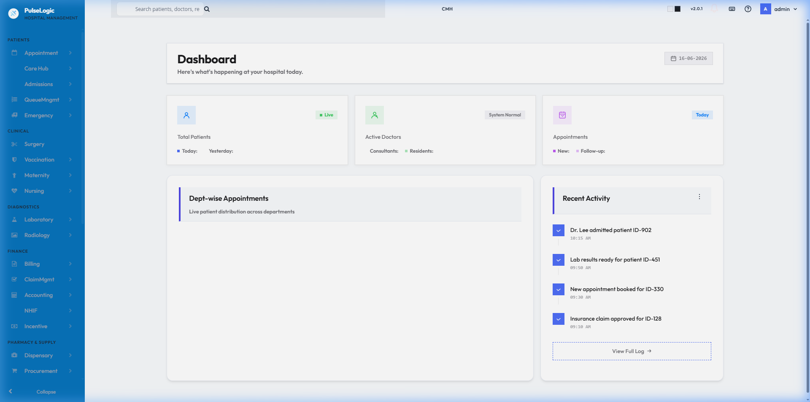
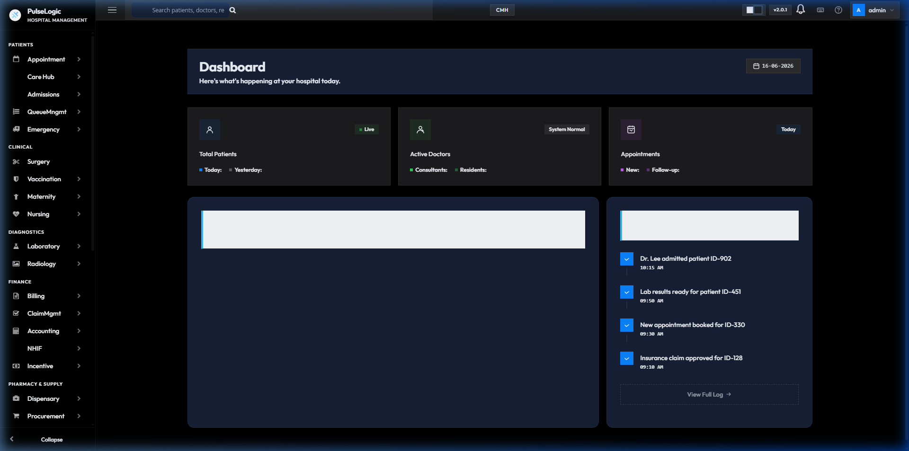
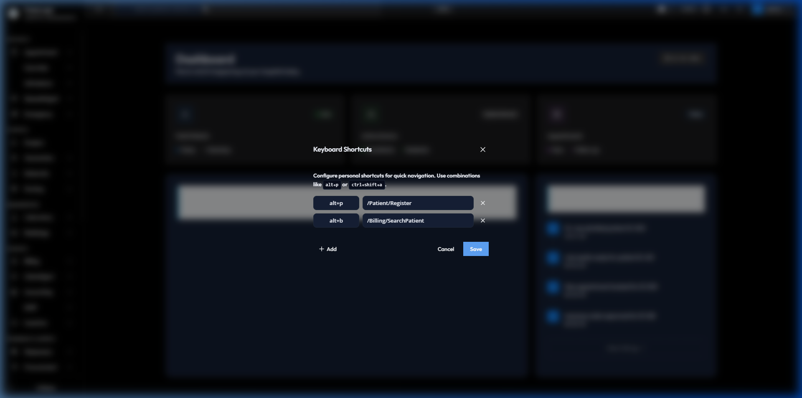
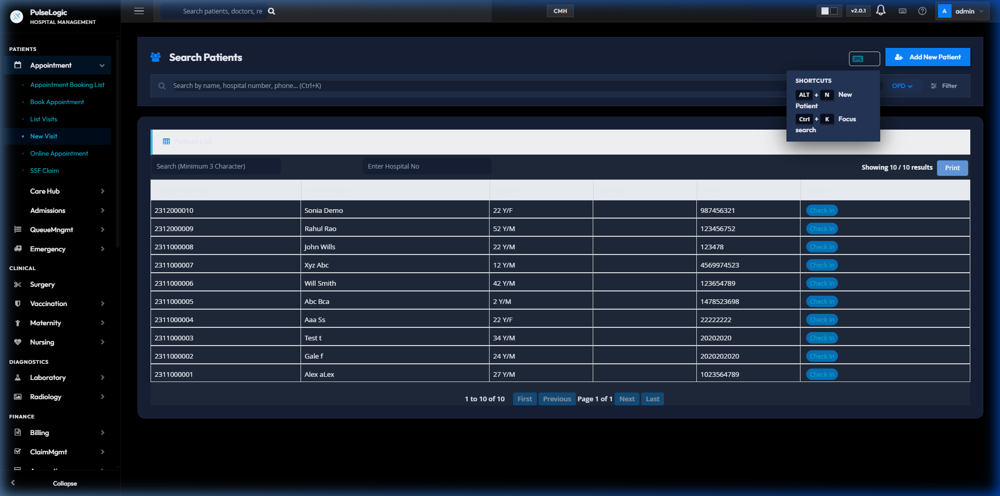
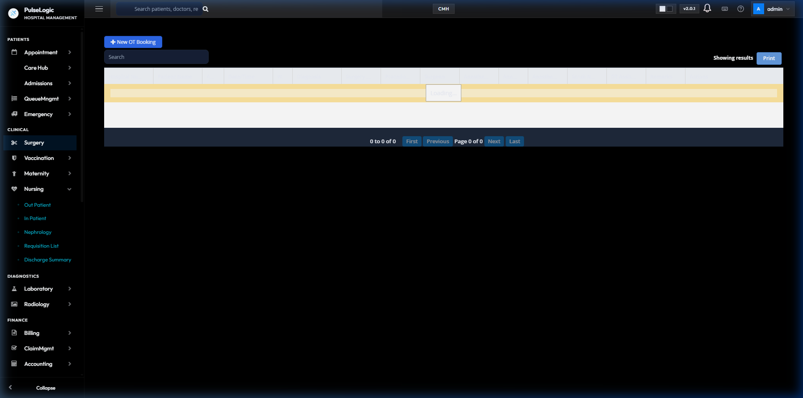
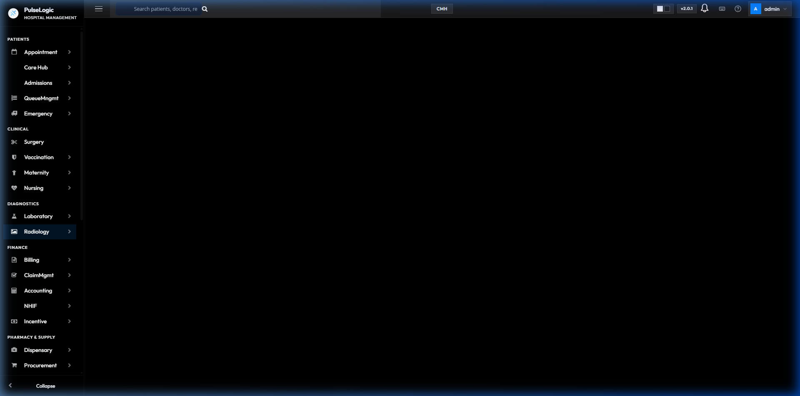
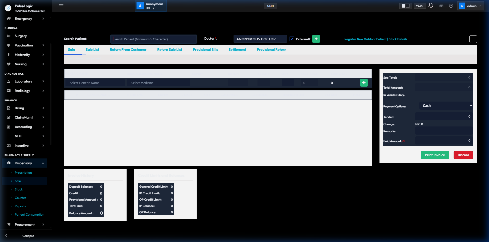
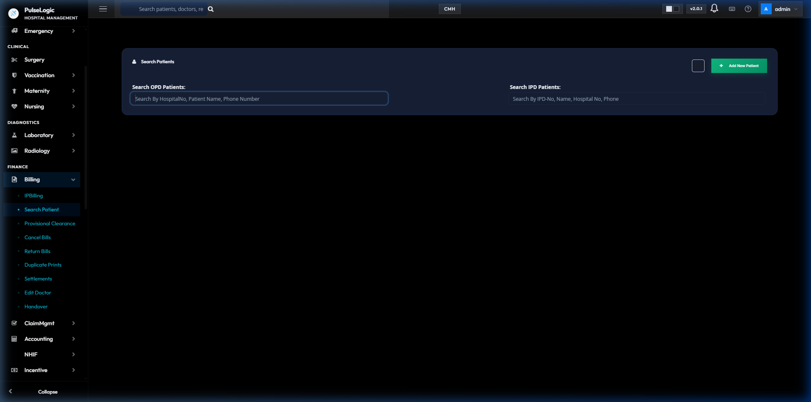

# PulseLogicHMR User Manual (Phase 1)

Welcome to **PulseLogicHMR**, your premium hospital management system, reimagined with a modern, hyper-clean Apple HIG-inspired interface. This guide will walk you through navigating the new application and performing day-to-day hospital workflows.

## 1. Introduction & The New Interface

The PulseLogicHMR interface is designed for speed, clarity, and beauty. 

### The Dashboard & Top Bar
- **Global Search**: Located directly in the top center, the widened spotlight search bar allows you to quickly find patients, invoices, or modules from anywhere in the app.
- **Keyboard Shortcuts**: Click the keyboard icon next to the notifications bell to open the Shortcuts Menu. You can configure custom hotkeys (e.g., `Alt+P` for patient registration) to jump instantly to your most used modules.
  
  
- **Theme Toggle**: Switch between **Light Mode** and **Dark Mode** on the fly by clicking the sun/moon icons in the top right. 
- **User Profile**: Click your avatar to access your profile settings, configure your date format (Gregorian/Nepali), and sign out securely.

---

## 2. Patients Module (Registration & Appointments)

The **Patients** group in the sidebar handles all front-desk operations, including registering new patients and managing their appointments.

### Step-by-Step: Registering a New Patient
1. In the sidebar under **PATIENTS**, click on **Appointment**.
2. From the top-right corner of the Patient Search screen, click the **+ Add New Patient** button.
3. **Fill Demographics**: Enter the patient's mandatory details including First Name, Last Name, Age, Gender, and Contact Number.
4. **Select Patient Type**: Choose whether the patient is a *General*, *Insurance*, or *Corporate* patient from the dropdown. This ensures correct billing tariffs are applied later.
5. **Save**: Click the **Register** button. The system will automatically generate a unique **Hospital Number (UHID)**.

### Step-by-Step: Booking an Appointment
1. Navigate to **PATIENTS > Appointment**.
2. Use the **Search Patients** bar to find an existing patient by their Name, Phone, or newly generated UHID.
3. Click the **Check In** button next to their name in the table.
4. **Select Doctor**: Choose the target Department (e.g., Cardiology, Orthopedics) and pick the Consulting Doctor.
5. **Confirm & Print**: Confirm the available time slot and print the appointment slip for the patient.

---

## 3. Clinical Module (Doctors & Surgery)

The **Clinical** group is the medical core of the hospital where doctors access the Electronic Medical Record (EMR), view patient queues, and plan surgeries.

### Step-by-Step: Managing the OPD Queue
1. In the sidebar under **CLINICAL**, click on **Care Hub** or **Nursing > Out Patient**.
2. **View Queue**: The dashboard will display all patients who have checked in for their appointments today, separated into OPD (Outpatient) and IPD (Inpatient).
3. **Open EMR**: Click on a patient's row to open their **Electronic Medical Record**.

### Step-by-Step: Writing Clinical Notes & Prescribing
1. Inside the patient's EMR, navigate to the **Clinical Notes** tab.
2. Enter the patient's **Chief Complaints**, **History of Present Illness (HPI)**, and physical examination findings.
3. **Order Investigations**: Click the 'Orders' section to request Lab Tests or Radiology scans. These requests are sent digitally to the respective departments immediately.
4. **Prescribe Medications**: Search for drugs from the formulary, specify dosage and frequency. Once saved, the prescription is instantly available at the Pharmacy Dispensary.

---

## 4. Diagnostics Module (Laboratory)

The **Diagnostics** group handles all Laboratory Information Systems (LIS) and Radiology workflows.

### Step-by-Step: Processing Lab Orders
1. In the sidebar under **DIAGNOSTICS**, click on **Laboratory**.
2. **Requisition List**: The main dashboard displays all pending test orders placed by doctors.
3. **Sample Collection**: Select an order to mark the sample as "Collected". The system will generate unique barcode labels for the test tubes.
4. **Enter Results**: Once the analyzer completes the test, navigate to the "Add Result" screen to input the values. (If your hospital uses machine interfacing, values will auto-populate).
5. **Verify & Sign**: A pathologist or senior technician must review the results and click **Sign Report**. Once signed, the report becomes visible in the Doctor's EMR and on the Patient Portal.

---

## 5. Pharmacy Module (Dispensary Sales)

The **Pharmacy & Supply** group manages drug dispensing, stock inventory, and procurement.

### Step-by-Step: Dispensing Prescribed Medications
1. In the sidebar under **PHARMACY & SUPPLY**, click on **Dispensary**. 
2. Ensure you have activated your shift counter (e.g., "Morning Counter").
3. **Load Prescription**: In the "Search Patient" bar, scan the patient's hospital card or type their UHID. The system will automatically pull up the doctor's electronic prescription.
4. **Verify Stock & Batch**: The items will populate in the grid. Select the specific batch/expiry for each drug. The system will calculate the total cost.
5. **Payment & Print**: Select the Payment Option (Cash, Card, etc.), collect the amount, and click **Print Invoice**.
6. **Dispense**: Hand the printed invoice and the medications to the patient. Inventory stock is automatically deducted upon sale.

---

## 6. Finance Module (Billing)

The **Finance** group handles out-patient invoicing, in-patient discharge billing, and insurance claims.

### Step-by-Step: Outpatient (OPD) Billing
1. In the sidebar under **FINANCE**, click on **Billing**.
2. Use the **Search OPD Patients** input box to find the patient.
3. **Review Charges**: The billing screen will load all pending charges accrued by the patient (e.g., Consultation fees, individual lab tests, procedures).
4. **Apply Discounts**: If applicable, select a discount scheme or enter a manual discount amount (requires authorization).
5. **Settle Bill**: Choose the Tender type, collect the cash/card payment, and print the receipt.

### Step-by-Step: Inpatient (IPD) Billing & Discharge
1. In the **FINANCE > Billing** menu, select the **IPBilling** sub-module or use the **Search IPD Patients** box.
2. **Aggregate Charges**: The IPD billing module aggregates all charges accrued during the patient's entire stay (Bed charges, daily doctor visits, nursing procedures, OT charges, medications).
3. **Provisional Bill**: Generate a provisional bill to show the patient's family their current running total.
4. **Final Discharge Bill**: Once the doctor marks the patient "Ready for Discharge", generate the final bill. 
5. **Clearance**: After the final payment is settled, the system will mark the patient as eligible to physically leave the ward, notifying the nursing station.
