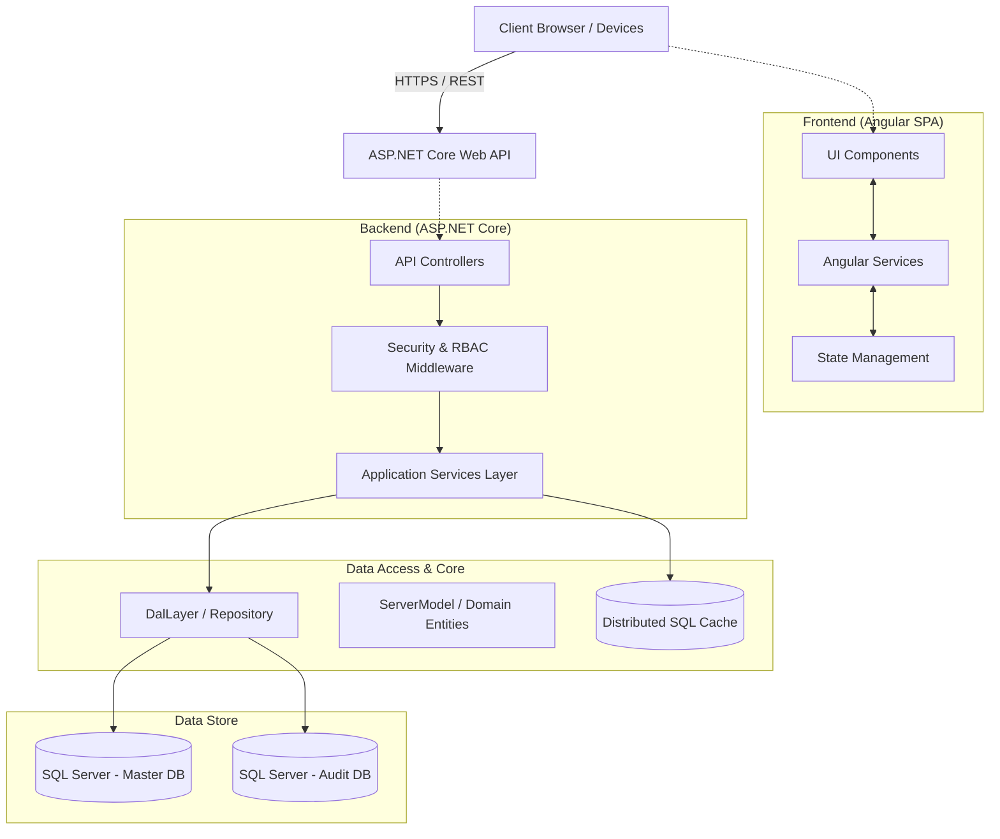

# System Overview: PulseLogic HMR v2.0.1

## High-Level Architecture
PulseLogic HMR follows a standard N-Tier (Multi-Tier) architectural pattern, separating concerns across distinct layers to promote maintainability, scalability, and security. It operates as a modern Web Application comprising a rich client-side Single Page Application (SPA) communicating via RESTful APIs to an ASP.NET Core backend.

## Architectural Layers

### 1. Presentation Layer (Frontend)
- **Technology**: Angular (TypeScript, HTML, SCSS/CSS).
- **Responsibility**: Provides the user interface, client-side routing, and interactive modules for the end-users (e.g., Doctors, Nurses, Billing Staff, Admins). It consumes the REST APIs exposed by the backend.

### 2. API / Controller Layer
- **Technology**: ASP.NET Core MVC (C#).
- **Responsibility**: Serves as the entry point for the frontend, handling HTTP requests, routing, input validation (Data Annotations), and returning standardized JSON responses.

### 3. Application / Service Layer
- **Technology**: ASP.NET Core Dependency Injection, C# Class Libraries.
- **Responsibility**: Contains the core business logic of the system. Controllers delegate requests to specific domain services (e.g., `BillingService`, `PharmacyService`, `ClinicalService`) that orchestrate workflows and enforce business rules.

### 4. Data Access Layer (DAL)
- **Technology**: Entity Framework Core, ADO.NET (where optimized performance is needed), C#.
- **Responsibility**: Abstracts the underlying database interactions. It maps domain entities (`ServerModel`) to database tables and executes queries/commands against SQL Server.

### 5. Cross-Cutting Concerns
- **Security**: Custom Role-Based Access Control (RBAC) and JWT Bearer Tokens.
- **Caching**: Distributed caching via SQL Server to offload repetitive data queries (e.g., settings, user permissions).
- **Auditing**: `Audit.SqlServer.Providers` hooks into the data layer to record structural changes to a dedicated Audit Table.
- **Error Handling**: Global exception handling middleware intercepts faults, logs them, and sanitizes API responses to the frontend.

## Deployment Profile
The application is designed to be hosted on IIS or Kestrel. The frontend is served as static files (`wwwroot/PulseLogicApp/dist`) directly by the ASP.NET Core middleware, while API calls are routed via the Web API pipeline.
