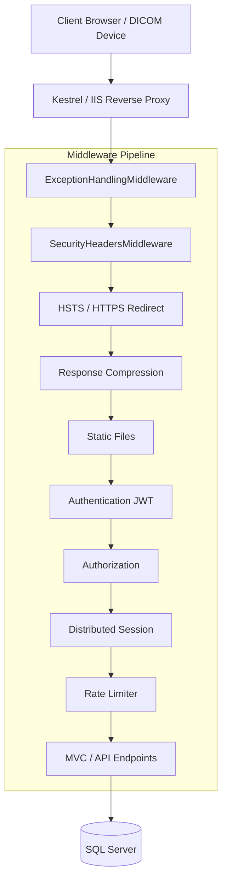

# PulseLogicHMR — Design and Architecture

> **Last Updated:** 2026-07-14 | **Version:** v2.0.1
> **Change Note:** Architecture hardened with middleware layers for security headers, rate limiting, and response compression.

---

## Architectural Pattern

PulseLogicHMR is a **Monolithic Web Application** with a hybrid frontend architecture:
1. **Server-Side Rendered (SSR) Shell:** ASP.NET Core MVC (Razor Views) handles the initial load, authentication (Login/Logout), and static file serving.
2. **Single Page Application (SPA):** Angular 7 drives the core hospital management interface (`/PulseLogicApp/`), served dynamically inside the MVC shell after authentication.

### Core Tiers
- **Presentation Tier:** Angular 7 (TypeScript), Razor Pages (HTML/C#), CSS3 Custom Properties (Theming)
- **Application Tier:** ASP.NET Core Web API (C# .NET 8)
- **Data Access Tier:** Entity Framework Core
- **Database Tier:** Microsoft SQL Server

---

## Request Pipeline Architecture

The ASP.NET Core middleware pipeline processes every request sequentially. In v2.0.1, this pipeline was significantly hardened.

### Security Improvements (v2.0.1)
- **SecurityHeadersMiddleware:** Injected at the top to protect against clickjacking, MIME-sniffing, and feature abuse.
- **Rate Limiter:** Positioned before MVC to drop brute-force login attempts (10/min) and API abuse (300/min) early in the pipeline.
- **ExceptionHandlingMiddleware:** Catches all exceptions, converts 401s and 499s appropriately, and ensures stack traces never reach the client.

---

## Component Architecture

The backend is modularised by hospital department, while the frontend mirrors this structure.

### Backend (C#) Modules
Located in `Code/Websites/PulseLogicHMR/Controllers/` and `Services/`:
- `Accounting`
- `Admission`
- `Billing`
- `Clinical`
- `DicomViewer` (Radiology Integration)
- `Emergency`
- `Inventory`
- `Pharmacy`
... and 40+ other departmental modules.

### Frontend (Angular) Modules
Located in `wwwroot/PulseLogicApp/src/app/`:
- Lazy-loaded feature modules mapped to routing constants (`app-routing.constant.ts`).
- Shared components (e.g., `global-search`, `msgbox`) in the `shared/` directory.

---

## Authentication & Authorization Architecture

### 1. Hybrid Token/Session Model
Because the app uses both MVC and Angular, it employs a hybrid state model:
- **JWT Bearer Token:** Generated on login, passed to Angular, stored in `localStorage`, and sent as the `Authorization: Bearer` header for all API calls.
- **Distributed Session (SQL Server):** Used by MVC controllers and Action Filters. Caches the user's RBAC permissions (`validpermissionlist`) to avoid hitting the database on every request.

### 2. Role-Based Access Control (RBAC) Engine
Located in `PulseLogicHMR.Security`:
- Users are assigned `RbacRole`s.
- Roles contain `RbacPermission`s.
- `PulseLogicViewFilter` intercepts requests and checks the required permission against the session-cached `validpermissionlist`.

---

## Data Architecture

### Database Contexts
The application uses Entity Framework Core with distinct contexts to isolate concerns:
- **CoreDbContext:** System parameters, core hospital configuration.
- **SecurityDbContext / RbacDbContext:** Users, roles, permissions.
- **[Module]DbContext:** Department-specific data (e.g., Billing, Pharmacy).

### Caching Strategy
- **Application State:** Cached in memory / distributed SQL cache (e.g., system parameters).
- **Session State:** Distributed SQL Cache (`AddDistributedMemoryCache` replaced with SQL Server distributed cache for farm scalability).
- **HTTP Caching:** API endpoints return `Cache-Control: no-store` to prevent caching of PHI (Protected Health Information) in the browser, while static assets are heavily cached.

---

## Integration Points

1. **DICOM Integration (`listener.exe`)**
   - External imaging machines push data to a local listener service.
   - The listener POSTs metadata to `/api/Dicom`.
   - *v2.0.1 Fix:* The DICOM API now properly validates the hashed password using `RBAC.GetUser()` instead of the flawed `IsValidUser()`.

2. **File Storage**
   - Uploads are saved to the physical disk (e.g., `fileuploads/`).
   - *v2.0.1 Fix:* Path traversal guards (`Path.GetFullPath()`) and whitelist validations ensure malicious files cannot compromise the host OS.

3. **External Portals**
   - ABDM, FHIR, and Nepali Receipt integration endpoints are structured as separate modular controllers.
